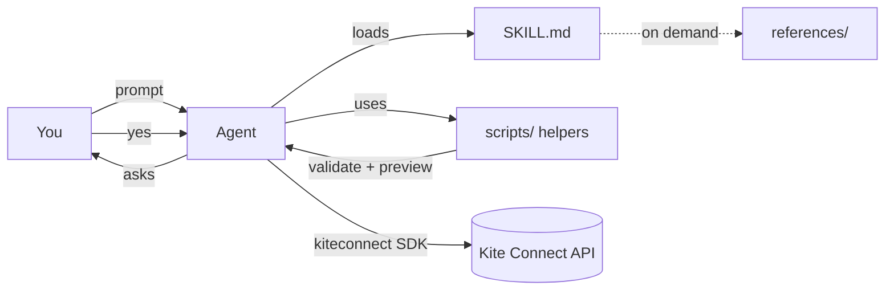

<div align="center">

# 🪁 Kite Skills

**Agent skills for trading and research on Indian markets with Zerodha Kite Connect**

Give Claude Code, Codex, or any [Agent Skills](https://agentskills.io)-compatible agent the ability to
read your Zerodha portfolio, pull NSE/BSE/NFO/MCX market data, build option chains with Greeks,
backtest with real Zerodha charges, and place orders **with guardrails**.

[](LICENSE)
[](https://www.python.org/)
[](https://pypi.org/project/kiteconnect/)
[](https://agentskills.io)
[](DISCLAIMER.md)

</div>

> [!CAUTION]
> **UNOFFICIAL PROJECT.** Kite Skills is an independent, community-maintained project. It is **not**
> built, endorsed, reviewed or supported by Zerodha Broking Ltd. or Zerodha Technology Pvt. Ltd.
> "Zerodha", "Kite" and "Kite Connect" are their trademarks and are used here only to describe
> compatibility. Trading involves substantial risk of loss. Nothing here is investment advice. Read the
> [full disclaimer](DISCLAIMER.md) before connecting a live account.

---

## Contents

- [Why this exists](#why-this-exists)
- [The skills](#the-skills)
- [Quick start](#quick-start)
- [Example prompts](#example-prompts)
- [Safety guardrails](#safety-guardrails)
- [Kite plans & 2026 compliance](#kite-plans--2026-compliance)
- [How it works](#how-it-works)
- [Repository layout](#repository-layout)
- [API coverage](#api-coverage)
- [Development](#development)
- [Troubleshooting](#troubleshooting)
- [FAQ](#faq)
- [Contributing](#contributing) · [Security](#security) · [License](#license)

---

## Why this exists

LLM agents are good at writing trading code but bad at the details that cost money: the weekly vs
monthly F&O symbol formats, lot sizes that change, the `market_protection` rule for market orders,
the 1 req/s quote limit, the static IP requirement since April 2026, and STT eating your scalping edge.

Kite Skills packages those details as **skills**: short instructions the agent loads only when it
needs them, plus tested helper scripts. The agent writes less code from memory and gets fewer
details wrong.

## The skills

| Skill | What it does | Needs |
|---|---|---|
| [**`kite-connect`**](skills/kite-connect/SKILL.md) | Login & daily token, orders (regular / AMO / iceberg / autoslice), GTT, alerts, holdings, positions, margins, exact charges, quotes, historical candles, instruments, WebSocket ticks & order updates, mutual funds | `kiteconnect` |
| [**`kite-options`**](skills/kite-options/SKILL.md) | Option chain builder (Kite has no chain API), IV & Greeks (Black-76 via synthetic forward), PCR, max pain, expected move, delta-based strike selection, multi-leg payoff, basket margin, safe leg-by-leg execution | `kiteconnect` + Connect plan |
| [**`kite-backtest`**](skills/kite-backtest/SKILL.md) | Chunked / cached / rate-limited history fetcher, Zerodha charges model (brokerage, STT, txn, SEBI, stamp, GST, DP), no-look-ahead backtester with MIS square-off, CAGR / drawdown / Sharpe report | stdlib (data fetch needs Connect plan) |

Each skill is self-contained, so you can install just the one you need.

## Quick start

### 1. Install the skills

**Any agent (Claude Code, Codex, Cursor, …), via the [`skills`](https://www.npmjs.com/package/skills) CLI:**

```bash
npx skills add byadnesh/Kite-Skills                       # all three skills
npx skills add byadnesh/Kite-Skills --skill kite-connect  # just one
```

**Claude Code plugin marketplace:**

```text
/plugin marketplace add byadnesh/Kite-Skills
/plugin install kite-skills@kite-skills
```

**Manual:** copy `skills/<name>/` into your agent's skills directory, e.g. `~/.claude/skills/`
(personal) or `.claude/skills/` (project).

### 2. Install the SDK

```bash
pip install --upgrade kiteconnect      # 5.x
pip install pandas                     # optional, for DataFrame analysis
```

### 3. Create a Kite Connect app (one time)

1. Go to <https://developers.kite.trade>, sign in and **create an app**: *Personal* (free) or *Connect* (₹500/month, adds market data).
2. Set the **Redirect URL** to `http://127.0.0.1:5678/kite/callback`.
3. Add your **static IP** under *IP Whitelist*. Order endpoints need it ([why](skills/kite-connect/references/compliance.md)).
4. Export the credentials (they stay on your machine; never paste them into a chat):

```bash
export KITE_API_KEY="your_api_key"
export KITE_API_SECRET="your_api_secret"
```

```powershell
$env:KITE_API_KEY = "your_api_key"; $env:KITE_API_SECRET = "your_api_secret"
```

### 4. Log in (every trading day)

```bash
python skills/kite-connect/scripts/login.py
```

Your browser opens the Kite login, and **you** sign in with your own 2FA. The script stores the day's
access token in `~/.kite-skills/session.json` with owner-only permissions. The token expires around
06:00 IST.

### 5. Ask your agent

```text
> Show my holdings with today's P&L
```

## Example prompts

<details open>
<summary><b>Portfolio & funds</b></summary>

- "Show my holdings sorted by P&L, and today's change"
- "What's my available margin?"
- "List my open F&O positions with net P&L"
- "Convert my SBIN intraday position to delivery"
</details>

<details>
<summary><b>Orders</b> (always previewed and confirmed)</summary>

- "Buy 5 shares of INFY at 1,480 limit, delivery"
- "Buy 1 lot of the NIFTY 25000 CE for the nearest expiry"
- "Place a stop-loss on my SBIN intraday position at 792"
- "Set a GTT OCO on my TCS holding: stop 3,900, target 4,500"
- "Cancel all my open orders on HDFCBANK"
- "Alert me when NIFTY 50 crosses 26,000"
</details>

<details>
<summary><b>Market data</b></summary>

- "LTP and day change for RELIANCE, TCS, HDFCBANK"
- "Daily candles for RELIANCE for the last 6 months, with 50/200 SMA"
- "Stream live ticks for NIFTY 50 and BANKNIFTY"
- "What's the lot size and tick size of the BANKNIFTY monthly future?"
</details>

<details>
<summary><b>Options</b></summary>

- "Show the NIFTY option chain for the nearest expiry with IV and delta"
- "What's the PCR and max pain for BANKNIFTY?"
- "Build a 16-delta NIFTY iron condor with 200-point wings and show max loss and margin"
- "What's my portfolio delta and theta?"
</details>

<details>
<summary><b>Backtesting & costs</b></summary>

- "Backtest a 50/200 SMA crossover on RELIANCE since 2018 vs buy & hold"
- "Backtest a 15-minute opening range breakout on SBIN for the last 6 months"
- "How much do charges eat on 20 NIFTY option round trips a day?"
- "What's the breakeven move for 1 lot of NIFTY futures after costs?"
</details>

## Safety guardrails

The skills tell the agent to follow these rules, and `validate_order.py` checks them in code:

| Guardrail | Behaviour |
|---|---|
| 🛑 **Preview + explicit "yes"** | Every order, modification, cancellation, GTT, conversion or MF order is shown as a ticket and needs confirmation. One approval covers one action. |
| 🎯 **LIMIT by default** | MARKET / SL-M only when asked, and always with `market_protection`. The exchange rejects them without it. |
| 1️⃣ **Minimum size by default** | 1 share or 1 lot when quantity isn't given |
| 📏 **Lot & tick validation** | Read from the live instruments dump. Lot sizes are never hardcoded. |
| 🧩 **Product/segment rules** | Blocks CNC/MTF on F&O and NRML on cash; flags indices as not tradable |
| 💰 **Size & fat-finger warnings** | Warns above ₹50,000 notional (set with `KITE_MAX_ORDER_VALUE`) or when the price is more than 5% from LTP |
| ⚠️ **Short-option warning** | Calls out unlimited or large risk and checks basket margin |
| 🕘 **Market-hours aware** | Warns when the market is closed and offers AMO. Warns when MIS is close to auto square-off. |
| 🔁 **No blind retries** | Order calls are never auto-retried. The agent checks the order book first. |
| 🏷️ **Tagged & journaled** | Every order gets a `tag`, and actions are logged to `~/.kite-skills/journal.jsonl`. |
| 🔐 **Secrets stay local** | Credentials come from env vars. Tokens are masked in output. The agent never asks for your password, PIN or TOTP and never automates login. |

Agents can still make mistakes. Start with the free Personal plan or small quantities, and read
every preview before you confirm.

## Kite plans & 2026 compliance

| | Personal (free) | Connect (₹500/mo) |
|---|:-:|:-:|
| Orders, GTT, alerts, portfolio, margins, MF | ✅ | ✅ |
| Quotes (LTP/OHLC/depth) | ❌ | ✅ |
| Historical candles | ❌ | ✅ |
| WebSocket streaming | ❌ | ✅ |
| Works with skills | `kite-connect` (trading/portfolio parts), `kite-backtest` cost model | all three |

**SEBI retail-algo framework (enforced from 1 April 2026):** order APIs only accept your whitelisted
static IP, there's a cap of 10 orders/sec, market orders need market protection, and autoslice is capped
at 10 slices. Details: [compliance.md](skills/kite-connect/references/compliance.md).

## How it works

Skills use **progressive disclosure** to keep the agent's context small:

```text
SKILL.md           ← loaded when the task matches the description (~250 lines:
                     setup, safety rules, constants, gotchas, core patterns)
 └─ references/*.md← read only when needed (full order params, WebSocket schema, …)
 └─ scripts/*.py   ← tested helpers the agent imports or runs instead of rewriting
 └─ examples/*.py  ← complete runnable programs to adapt
```



## Repository layout

```text
skills/
├── kite-connect/
│   ├── SKILL.md
│   ├── references/   auth · orders · gtt-and-alerts · portfolio · margins-and-charges ·
│   │                 market-data · instruments · websocket · mutual-funds ·
│   │                 errors-and-limits · compliance · common-workflows
│   ├── scripts/      kite_client.py   login.py   instruments.py   validate_order.py
│   │                 market_hours.py  trade_journal.py
│   └── examples/     place_equity_order · place_fno_order · order_lifecycle · gtt_orders ·
│                     price_alert · portfolio_dashboard · margin_check ·
│                     historical_candles · live_ticker
├── kite-options/
│   ├── SKILL.md
│   ├── references/   option-chain · greeks-and-iv · strategies
│   ├── scripts/      option_chain.py  greeks.py  kite_common.py
│   └── examples/     option_chain_view · iron_condor
└── kite-backtest/
    ├── SKILL.md
    ├── references/   data-fetching · cost-model · pitfalls
    ├── scripts/      fetch_history.py  charges.py  backtest.py  kite_common.py
    └── examples/     sma_crossover · opening_range_breakout
tests/                offline unit tests (no API key needed)
.claude-plugin/       Claude Code marketplace manifest
bin/install.js        npx installer wrapper
```

## API coverage

| Area | Endpoints / SDK | Docs |
|---|---|---|
| Auth | `login_url`, `generate_session`, `invalidate_access_token`, `profile` | [auth.md](skills/kite-connect/references/auth.md) |
| Orders | `place_order`, `place_autoslice_order`, `modify_order`, `cancel_order`, `exit_order`, `orders`, `order_history`, `trades`, `order_trades`, `trigger_range` | [orders.md](skills/kite-connect/references/orders.md) |
| GTT & alerts | `place_gtt`, `get_gtts`, `modify_gtt`, `delete_gtt`, `/alerts` REST | [gtt-and-alerts.md](skills/kite-connect/references/gtt-and-alerts.md) |
| Portfolio | `holdings`, `positions`, `convert_position`, `get_auction_instruments` | [portfolio.md](skills/kite-connect/references/portfolio.md) |
| Funds & charges | `margins`, `order_margins`, `basket_order_margins`, `get_virtual_contract_note` | [margins-and-charges.md](skills/kite-connect/references/margins-and-charges.md) |
| Market data | `ltp`, `ohlc`, `quote`, `historical_data` | [market-data.md](skills/kite-connect/references/market-data.md) |
| Instruments | `instruments`, `mf_instruments` + resolver | [instruments.md](skills/kite-connect/references/instruments.md) |
| Streaming | `KiteTicker` (ltp/quote/full, order updates) | [websocket.md](skills/kite-connect/references/websocket.md) |
| Mutual funds | `place_mf_order`, `mf_orders`, `place_mf_sip`, `mf_sips`, `mf_holdings` | [mutual-funds.md](skills/kite-connect/references/mutual-funds.md) |
| Errors & limits | exceptions, HTTP codes, rate limits, retry policy | [errors-and-limits.md](skills/kite-connect/references/errors-and-limits.md) |
| Options analytics | chain builder, IV, Greeks, PCR, max pain, strategies | [kite-options](skills/kite-options/SKILL.md) |
| Backtesting | history fetcher, cost model, engine | [kite-backtest](skills/kite-backtest/SKILL.md) |

## Development

```bash
git clone https://github.com/byadnesh/Kite-Skills.git
cd Kite-Skills
python -m unittest discover -s tests -v      # offline; no Kite account needed
```

The tests cover order validation, market hours, instrument resolution against a fake dump, Black-Scholes
pricing, IV round-trips and finite-difference Greeks, the chain builder against a synthetic market,
payoff and breakeven maths, every charge component, backtest fill timing, intraday square-off and P&L
reconciliation, plus repo checks: frontmatter, links, no hardcoded secrets, and the unofficial notice.

CI runs the same suite on Linux, macOS and Windows for Python 3.9 to 3.13.

## Troubleshooting

| Symptom | Fix |
|---|---|
| `TokenException` / 403 | Token expired (~06:00 IST daily) or you logged in elsewhere. Run `login.py` again. |
| `PermissionException` on quotes/history | You're on the Personal plan. Upgrade to Connect for market data. |
| Order rejected with an IP message | Whitelist this machine's public static IP in the developer console |
| "market protection" rejection | Pass `market_protection=-1` for MARKET / SL-M |
| "lot size" / "tick size" rejection | Resolve the contract with `instruments.py` and use its `lot_size` / `tick_size` |
| `429 Too many requests` | Quotes are limited to 1/s and history to 3/s. Batch your keys and back off. |
| `UnicodeEncodeError` on Windows | Already handled in the scripts. In your own code, run `chcp 65001` or set `PYTHONIOENCODING=utf-8`. |

## FAQ

**Is this affiliated with Zerodha?**
No. It's an independent open-source project. See [DISCLAIMER.md](DISCLAIMER.md).

**Will the agent trade without asking me?**
The skills tell the agent to show a preview and get an explicit "yes" before every state-changing
call, and the examples enforce that with a typed prompt. You are still responsible for what you
approve, and for any unattended automation you build yourself.

**Can it log in for me automatically?**
No, by design. Exchange rules require the account holder to complete 2FA personally every day. The
skill never asks for or stores your password, PIN or TOTP seed.

**Does Zerodha have an official AI integration?**
Zerodha publishes an official [Kite MCP server](https://github.com/zerodha/kite-mcp-server). This
project is an independent alternative focused on agent skills, local Python helpers, options
analytics and backtesting.

**Can I use this for other brokers?**
The `kite-options` maths and the `kite-backtest` engine are broker-agnostic. Only the Zerodha cost
model and the data fetchers are Kite-specific.

## Roadmap

- [ ] Paper-trading broker shim (same interface as `KiteConnect`, simulated fills)
- [ ] Commodity (MCX) and currency charge models
- [ ] Portfolio risk skill: VaR, beta to NIFTY, sector concentration
- [ ] Tax P&L helper (STCG/LTCG/F&O business income) from the trade journal
- [ ] Evals for each skill (prompt → expected tool usage)

## Contributing

Contributions are welcome. See [CONTRIBUTING.md](CONTRIBUTING.md). The short version: keep `SKILL.md`
short, put depth in `references/`, add tests for any script change, never commit credentials or market
data, and keep the unofficial notice.

## Security

Found a way the skills could leak credentials or place an order without confirmation? Please report it
privately as described in [SECURITY.md](SECURITY.md).

## License

[MIT](LICENSE) © 2026 Kite Skills contributors.

<sub>Zerodha, Kite and Kite Connect are trademarks of Zerodha Broking Ltd. NSE, BSE and MCX are
trademarks of their respective exchanges. This project is not affiliated with, endorsed by or sponsored
by any of them. Investments in securities markets are subject to market risks. Read all related
documents carefully before investing.</sub>
